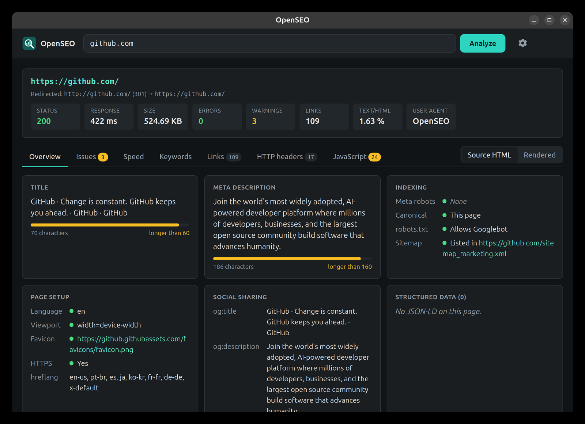
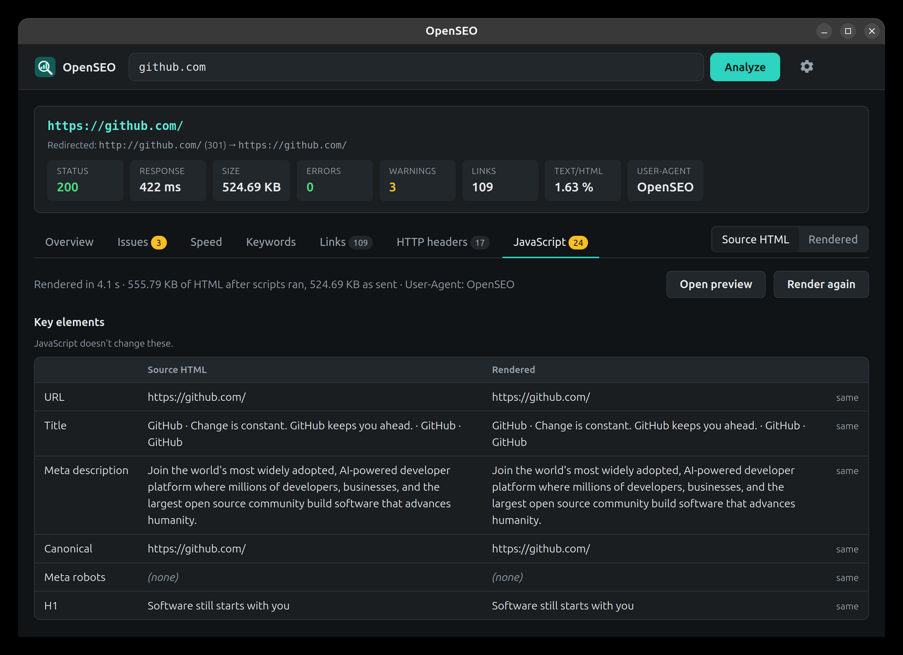

<p align="center"></p>

<h1 align="center">OpenSEO</h1>

<p align="center">Checks a single web page for common technical and on-page SEO problems.
A desktop app and command-line tool for Linux, Windows and macOS that runs on your
computer.</p>



## What the report covers

- **Page basics**: title and meta description with common length guidelines, headings
  outline, text-to-HTML ratio, meta keywords.
- **Indexing**: meta robots and `X-Robots-Tag`, canonical URL, whether robots.txt lets
  Googlebot crawl the page (and which rule decides), whether the page is listed in
  the site's XML sitemaps.
- **Issues**: 57 rule-based checks grouped as errors, warnings and notices, with line
  and column in the source. They cover titles, descriptions, headings, image `alt`
  text and dimensions, HTTPS, mixed content, HSTS, redirect chains, canonical and
  hreflang mistakes, viewport, language, Open Graph and Twitter cards, JSON-LD
  validity, favicon, and more.
- **JavaScript**: the page is also loaded in a hidden browser. OpenSEO analyzes the
  rendered page and shows what scripts change: title, description, canonical,
  robots, H1, and links added or removed. Every tab can switch between the source
  HTML and the rendered page.
- **Keywords**: one-, two- and three-word phrases with occurrences and density
  (English stop words are ignored). Density is a descriptive count, not a target.
- **Links**: internal and external, follow and nofollow, with anchor text.
- **Speed**: Lighthouse scores, Core Web Vitals from real Chrome users (when Google
  has enough data) and improvement tips, from Google PageSpeed Insights.
- **HTTP**: status, redirect chain, response time and headers.



## What it can and can't tell you

OpenSEO checks a page against search engines' published guidelines and common
practice: whether it can be crawled and indexed, whether its metadata and markup are
in order, and whether scripts change what crawlers see. These are technical
prerequisites. They are not what decides rankings.

- **It doesn't measure** content quality, relevance to a search, links from other
  sites, competition or actual rankings. Those matter more for where a page ranks.
- **Many checks are rules of thumb.** Length ranges are approximations (Google
  truncates by pixel width and often rewrites titles and snippets), notices are
  suggestions, and some warnings can be deliberate choices.
- **A clean report doesn't mean a page will rank,** and fixing a reported issue may
  not change its position. Errors such as `noindex` or a robots.txt block do keep a
  page out of search results.
- **It looks at one page at a time,** as fetched from your computer, at one moment.

## Install

Download the installer for your system from the
[Releases page](https://github.com/TahaHachana/OpenSEO/releases):

| System | File |
|---|---|
| Linux | `.AppImage` (any distribution), `.deb` (Debian, Ubuntu), `.rpm` (Fedora, openSUSE) |
| Windows 10/11 | `.msi` or `_x64-setup.exe` |
| macOS 10.15+ | `.dmg` (universal: Apple Silicon and Intel) |

The builds are not code-signed, so your system will warn you the first time:

- **macOS**: if the app "is damaged" or "can't be opened", run
  `xattr -cr /Applications/OpenSEO.app`, or right-click the app and choose **Open**.
- **Windows**: if SmartScreen warns, choose **More info → Run anyway**.
- **AppImage**: make it executable first (`chmod +x OpenSEO_*.AppImage`).

### Command-line tool

The same release has `openseo` archives for Linux, Windows and macOS. Unpack and put the
binary on your `PATH`.

```sh
openseo report example.com                # human-readable report
openseo report example.com --json         # everything, as JSON
openseo report example.com -v --user-agent chrome-mobile
openseo speed example.com --strategy desktop --api-key "$KEY"
```

`openseo report --help` lists every option. The CLI doesn't render JavaScript (that
needs the desktop app's browser engine); everything else matches the app.

## Data sources and their limits

| Source | Where it runs | Limits |
|---|---|---|
| The page itself | Fetched from your computer, with the User-Agent chosen in Settings (OpenSEO by default; Chrome desktop, Chrome mobile, Googlebot or custom). | Some sites block unknown bots: if you get a 403, try a Chrome preset. Sites that check Googlebot by IP address block a fake Googlebot. |
| Rendered page | A hidden webview on your computer (WebKitGTK on Linux, WebView2 on Windows, WebKit on macOS). The page's scripts run, as when you visit it, in a private session that is thrown away. | Waits until the page stops changing, at most 20 s. Content that loads only when you scroll is missed, and shadow DOM isn't captured. You can turn rendering off in Settings. |
| robots.txt and sitemaps | Fetched from the site, read the way Google documents it, for the `Googlebot` token. | Up to 20 sitemap files per check (the most relevant first), so very large sites may be cut short; the report says so. This simulates Google's rules but isn't Google's verdict. |
| PageSpeed Insights | Google's API, only when you start a test. It sends the page URL to Google. | Needs a free [API key](https://developers.google.com/speed/docs/insights/v5/get-started) in practice: the keyless quota is shared and usually used up. Real-user data exists only for pages with enough Chrome traffic. |

Not covered, because there are no free sources: backlinks, domain authority, keyword
search volume, rankings. OpenSEO analyzes one page at a time; it doesn't crawl whole
sites.

## Privacy

There is no account, telemetry or OpenSEO server. The app talks to the site you
analyze, and to Google only when you run a PageSpeed test. Settings (User-Agent,
PageSpeed key, rendering on or off) are stored in the app's data folder, in plain
text.

## Build from source

You need [Rust](https://rustup.rs/) 1.88 or newer. On Linux, also the WebKitGTK
development packages:

```sh
# Debian / Ubuntu
sudo apt install libwebkit2gtk-4.1-dev libsoup-3.0-dev libjavascriptcoregtk-4.1-dev \
  librsvg2-dev libayatana-appindicator3-dev build-essential
```

Windows needs the Microsoft C++ Build Tools (WebView2 ships with Windows 10/11); macOS
needs the Xcode command-line tools. See [Tauri's prerequisites](https://v2.tauri.app/start/prerequisites/)
for details.

```sh
cargo run -p openseo-app                         # the desktop app
cargo run -p openseo-app -- example.com          # …analyzing a page on startup
cargo run -p openseo-cli -- report example.com   # the CLI
cargo test --workspace                           # tests (no network needed)
```

To build installers, install the Tauri CLI (`cargo install tauri-cli --version "^2"`)
and run `cargo tauri build` in `app/`. Bundles land in `target/release/bundle/`.

## Project layout

```
crates/openseo-core   Library: fetching, HTML analysis, rules, robots.txt and
                      sitemaps, PageSpeed Insights. No UI dependency.
crates/openseo-cli    The `openseo` command-line tool.
app/src-tauri         Desktop app (Tauri v2): commands, settings, the hidden renderer.
app/ui                Its interface: plain HTML, CSS and JavaScript, no build step.
```

[PLAN.md](PLAN.md) has the roadmap and the design decisions.

## History

OpenSEO started in 2012 as a website built with F# and WebSharper, on top of
[SEOLib](https://github.com/TahaHachana/SEOLib). The hosted site is gone and the
project was unmaintained for years. This is a rewrite in Rust as a desktop app, so
it runs without hosting. It started from SEOLib's checks, with thresholds updated
and checks added based on current search engine documentation. The F# code is in the git history.

## License

Licensed under either of

- Apache License, Version 2.0 ([LICENSE-APACHE](LICENSE-APACHE))
- MIT license ([LICENSE-MIT](LICENSE-MIT))

at your option.
